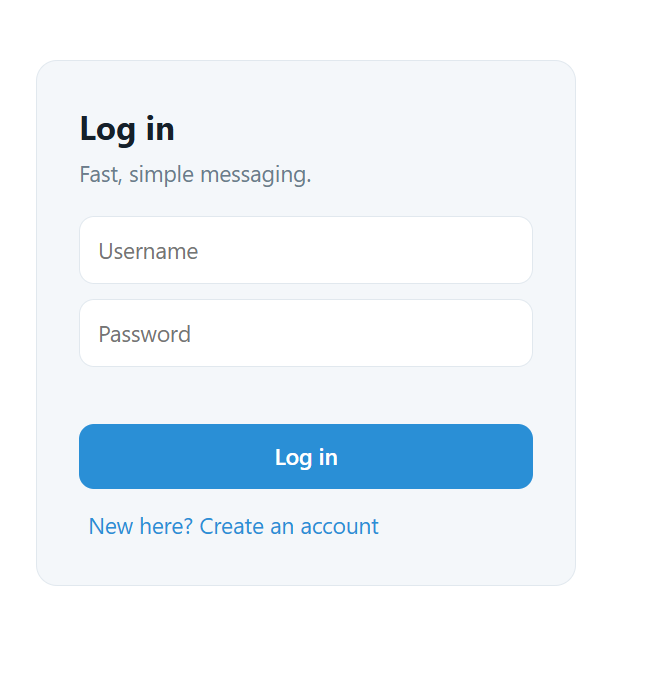
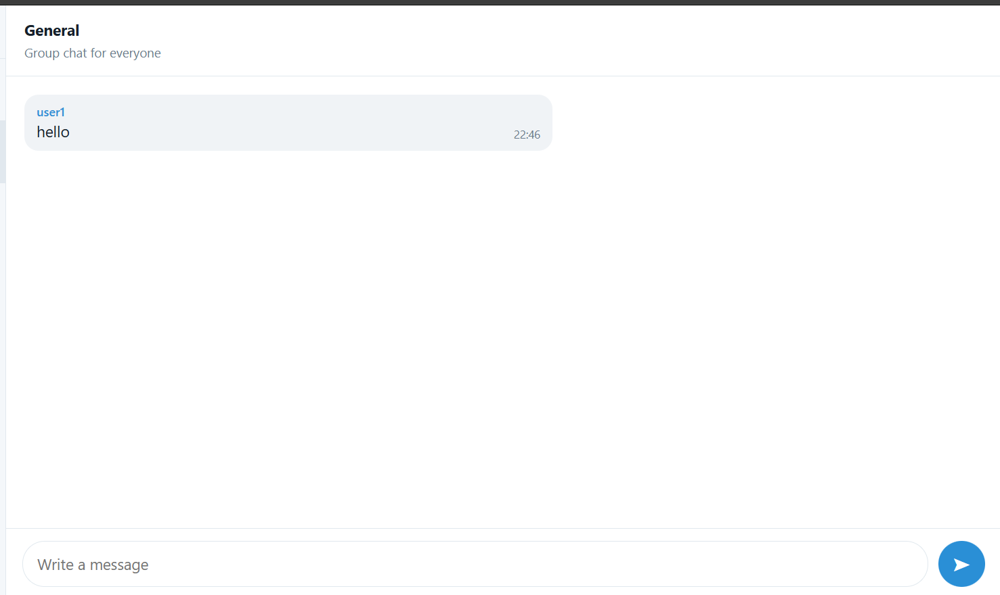
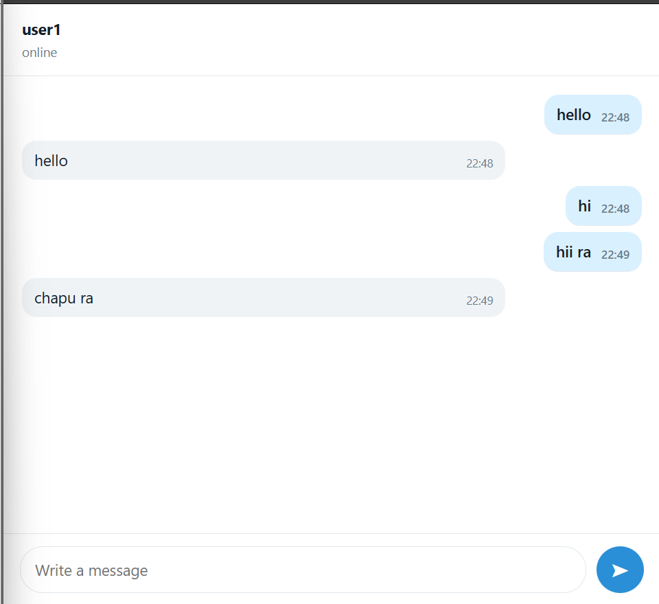
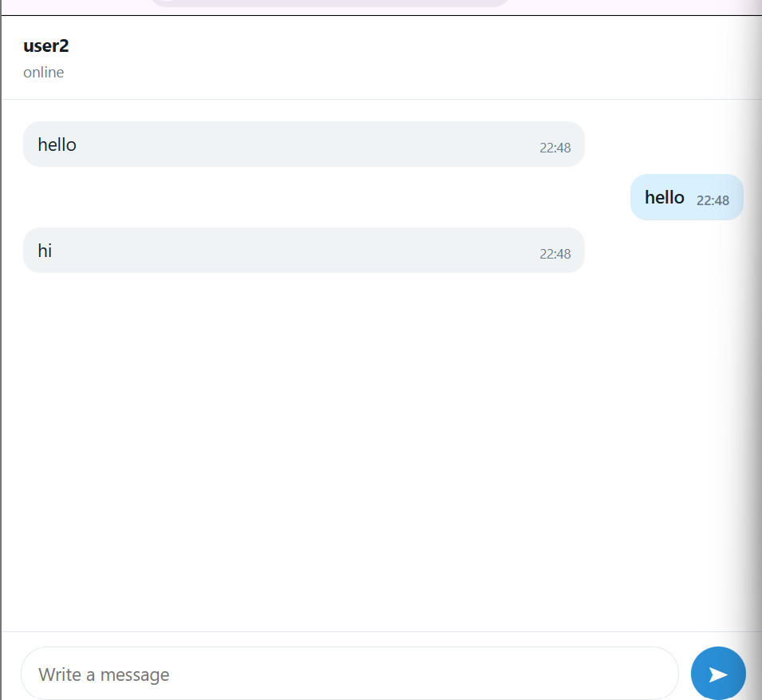
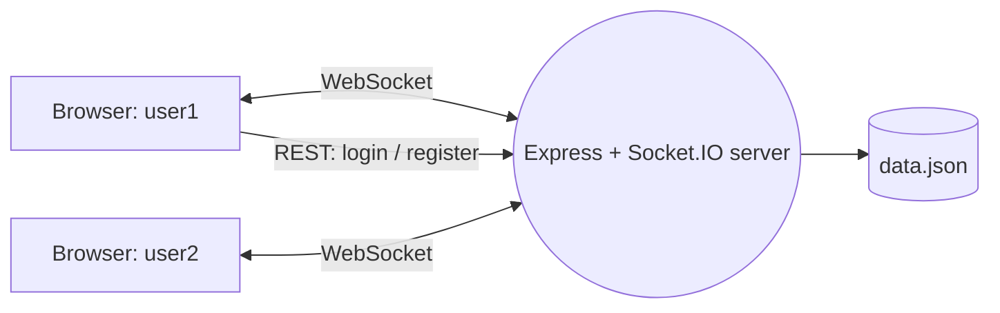

<div align="center">


# Telegram Clone

**A fast, real-time messaging web app inspired by Telegram.**

Private chats, group chat, live online status and typing indicators, all powered by WebSockets.


[Live Demo](https://telegram-clone-2h5b.onrender.com/) · [Report a Bug](../../issues) · [Request a Feature](../../issues)

</div>

---

## Table of Contents

- [About the Project](#about-the-project)
- [Screenshots](#screenshots)
- [Features](#features)
- [Tech Stack](#tech-stack)
- [How It Works](#how-it-works)
- [Getting Started](#getting-started)
- [Project Structure](#project-structure)
- [Deployment](#deployment)
- [Future Scope](#future-scope)
- [Author](#author)

## About the Project

Telegram Clone is a full-stack, real-time chat application built as a web technology project. Users create an account, see who is online, and talk instantly in a shared group or in private one-to-one conversations. Messages are delivered over WebSockets with Socket.IO, so there is no page refresh and no polling.

The goal was to build a clean, simple, and working messenger that shows the core ideas behind apps like Telegram: authentication, real-time events, and persistent history.

## Screenshots

<div align="center">

| Log in | Group chat |
| :---: | :---: |
|  |  |

| Private chat (user1) | Private chat (user2) |
| :---: | :---: |
|  |  |

</div>

## Features

| | Feature | Description |
| :-: | --- | --- |
| 🔐 | **Secure authentication** | Sign up and log in with passwords hashed using bcrypt and sessions handled by JWT. |
| 💬 | **Private chats** | One-to-one conversations visible only to the two people in them. |
| 👥 | **Group chat** | A shared General room that everyone can read and post in. |
| 🟢 | **Online status** | Green dot shows who is online right now. |
| ✍️ | **Typing indicator** | See "typing..." while the other person writes. |
| 🔔 | **Unread badges** | A count appears on chats with new messages. |
| 🔎 | **Chat search** | Filter the chat list as you type. |
| 💾 | **Message history** | Conversations are saved and reloaded after a refresh. |
| 🌗 | **Light and dark theme** | Follows your device setting automatically. |
| 📱 | **Responsive design** | Works on desktop and mobile screens. |

## Tech Stack

| Layer | Technology |
| --- | --- |
| Runtime | Node.js |
| Server | Express |
| Real-time | Socket.IO (WebSockets) |
| Authentication | JSON Web Tokens, bcryptjs |
| Storage | JSON file (`data.json`) |
| Frontend | HTML5, CSS3, vanilla JavaScript |

## How It Works



1. A user registers or logs in through the REST API and receives a JWT.
2. The browser opens a Socket.IO connection and sends the token to prove who it is.
3. Messages are sent as events, saved to storage, and pushed instantly to the right people.

## Getting Started

### Prerequisites

- [Node.js](https://nodejs.org) 18 or higher

### Installation

```bash
# 1. Clone the repository
git clone https://github.com/YOUR-USERNAME/telegram-clone.git

# 2. Go into the project folder
cd telegram-clone

# 3. Install dependencies
npm install

# 4. Start the server
npm start
```

Open **http://localhost:3000** in your browser. To test chatting, open a second window (incognito works) and create another account.

### Environment variables

| Variable | Purpose | Default |
| --- | --- | --- |
| `JWT_SECRET` | Secret key used to sign login tokens. Set your own in production. | `dev-secret-change-me` |
| `PORT` | Port the server listens on. | `3000` |

## Project Structure

```
telegram-clone/
├── public/
│   └── index.html      # Complete chat interface
├── screenshots/        # Images used in this README
├── assets/             # Logo
├── server.js           # API, authentication, Socket.IO events, storage
├── package.json
└── README.md
```

## Deployment

The app runs on any Node.js host that supports WebSockets, such as [Render](https://render.com).

- **Build command:** `npm install`
- **Start command:** `npm start`
- **Environment variable:** `JWT_SECRET` set to a long random string

On free hosting plans the file storage can reset when the server restarts. For permanent data, use a database such as MongoDB.

## Future Scope

- [ ] Image and file sharing
- [ ] Create custom groups and channels
- [ ] Read receipts
- [ ] Move storage to MongoDB or PostgreSQL
- [ ] End-to-end encryption
- [ ] Push notifications

## Author

**T. Sashank**

- GitHub: [@YOUR-USERNAME](https://github.com/YOUR-USERNAME)

---

<div align="center">

If you like this project, give it a ⭐ on GitHub.

</div>
